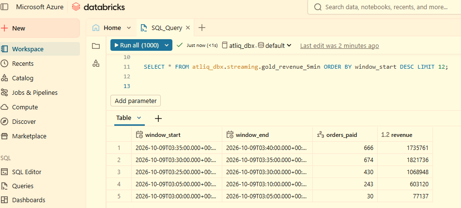
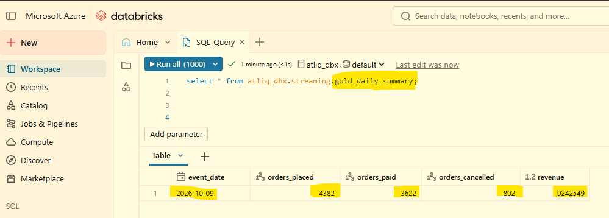

# AtliQ Commerce — Phase 2: Real-Time Lane

A streaming "speed lane" for AtliQ Commerce. Order events flow from a Python producer into **Kafka (Confluent Cloud)**, are processed by **Databricks Structured Streaming** through Bronze, Silver and Gold layers, and are kept healthy by an hourly **Apache Airflow** DAG.

> **Developed by:** Ashish Rijal

---

## 🎯 Purpose of the Project

Phase 1 syncs the OLTP database to the warehouse once a night, so leadership only sees yesterday's numbers. The operations team needs answers to questions like *how many orders are coming in right now?* and *did revenue suddenly drop in the last ten minutes?*

Phase 2 adds a second lane that runs beside the batch pipeline:

- Streams live order events (placed, paid, shipped, cancelled) through Kafka the moment they happen
- Processes them continuously with the medallion pattern (Bronze → Silver → Gold)
- Produces a live 5-minute revenue ticker and a daily summary table
- Uses Airflow for data-quality checks, table maintenance and the daily rollup

This project is standalone. It does not touch the Phase 1 deployment.

```
Phase 1 (batch lane)   nightly      OLTP → ADF → medallion → Fabric
Phase 2 (speed lane)   continuous   events → Kafka → Streaming
                                    + Airflow for the scheduled work around the stream
```

---

## 🏗️ Architecture


| Layer | Component | Role |
|---|---|---|
| **Event source** | Python producer (`order_event_producer.py`) | Simulates live orders. Emits `order_placed`, `payment_received`, `order_shipped`, `order_cancelled` as JSON, keyed by `order_id` so one order's events stay in order within a partition |
| **Streaming backbone** | Apache Kafka on Confluent Cloud | Topic `atliq.orders.events` (SASL_SSL, API key auth) |
| **Bronze** | Delta table `bronze_order_events` | Raw Kafka records (key, value, topic, partition, offset, timestamp). No parsing |
| **Silver** | Delta table `silver_order_events` | JSON parsed with an explicit schema, `event_ts` cast to timestamp, 10-minute watermark, de-duplicated on `event_id` |
| **Gold** | Delta table `gold_revenue_5min` | `payment_received` events in 5-minute tumbling windows: `orders_paid` and `revenue` |
| **Gold (daily)** | Delta table `gold_daily_summary` | Per date: orders placed, paid, cancelled and revenue |
| **Orchestration** | Apache Airflow (Docker, local) | Hourly DAG `atliq_streaming_ops` |
| **Serving** | Databricks SQL | Live revenue ticker and daily summary queries |

All tables live in Unity Catalog under `atliq_dbx.streaming`. Streaming checkpoints are stored in the Volume `atliq_dbx.streaming.checkpoints` (separate folders for `bronze`, `silver` and `gold`).

---

## ⏰ Schedule

| Item | Detail |
|---|---|
| DAG | `atliq_streaming_ops` |
| Schedule | `@hourly` (`catchup=False`, start date 2026-08-01) |
| Retries | 2 per task |
| Task order | `check_fresh_events` → `optimize_tables` → `refresh_daily_summary` |

| Task | What it does |
|---|---|
| `check_fresh_events` | Data-quality gate. Fails (`assert_true`) when no events landed in the last 120 minutes |
| `optimize_tables` | Runs `OPTIMIZE` on the Silver and Gold tables to compact small streaming files |
| `refresh_daily_summary` | Rebuilds `gold_daily_summary` from Silver: per date, orders placed, paid, cancelled and revenue |

The streaming notebook uses `trigger(availableNow=True)` because Databricks serverless requires it. Each run processes everything new in Kafka and then stops.

---

## 🧰 Technologies Used

| Category | Tools |
|---|---|
| Event transport | Apache Kafka on Confluent Cloud (`confluent-kafka` Python client) |
| Stream processing | Azure Databricks, PySpark Structured Streaming |
| Storage | Delta Lake, Unity Catalog (managed tables and Volume checkpoints) |
| Orchestration | Apache Airflow 3 (Docker), Databricks provider (`DatabricksSqlOperator`) |
| Query / serving | Databricks SQL warehouse |
| Languages | Python, SQL |

---

## 🔑 Key Design Points

- **Idempotent Silver:** every event has a unique `event_id`, used with a watermark to drop duplicates.
- **Ordering by key:** Kafka message key is `order_id`, so one order's lifecycle stays in one partition.
- **Watermarks and late data:** Gold windows only emit after the watermark passes the window end, so the newest rows run about 10 to 15 minutes behind. That is expected behavior, not a bug.
- **One checkpoint per stream:** sharing a checkpoint folder between streams causes duplicates or a stream that will not start.
- **Quality gate:** the DAG stops the maintenance and rollup tasks when data stops arriving.

---

## ✅ Results

**Airflow DAG: healthy run**


**Airflow DAG: quality gate failing when the producer is stopped.** `check_fresh_events` fails and the downstream tasks show `upstream_failed`.


**`gold_revenue_5min`: live 5-minute revenue windows**



**`gold_daily_summary`: daily rollup (2026-10-09)**



| event_date | orders_placed | orders_paid | orders_cancelled | revenue |
|---|---|---|---|---|
| 2026-10-09 | 4,382 | 3,622 | 802 | 9,242,549 |

---

## 📁 Repository Structure

```
Eng_atliq_capstone_stream/
├── 00_docs/                              # Implementation guide and project documents
├── 01_producer/
│   ├── .env.example                      # Template for Confluent Cloud credentials
│   └── order_event_producer.py           # Kafka order event producer
├── 02_databricks/
│   └── NB_Bronze_To_Silver_To_Gold_Stream.py   # Bronze, Silver and Gold streams
├── 03_airflow/
│   └── dags/
│       └── atliq_streaming_ops_dag.py    # Hourly ops DAG
├── screenshots/                          # Architecture diagram and result screenshots
│   ├── phase2_architecture.png
│   ├── DAG Success.png
│   ├── DAG Failure.png
│   ├── gold_revenue_5min_table.png
│   └── gold_daily_summary_table.png
└── README.md
```

The numbered folders follow the order of the data flow: producer, streaming, orchestration.

---

## 🚀 Getting Started

1. **Confluent Cloud:** create a Basic cluster, the topic `atliq.orders.events`, and a cluster-scoped API key. Note the bootstrap server.
2. **Producer:** go to `01_producer`, copy `.env.example` to `.env`, fill in `KAFKA_BOOTSTRAP`, `KAFKA_API_KEY`, `KAFKA_API_SECRET` and `KAFKA_TOPIC`, then run:
   ```bash
   pip install -r requirements.txt
   python order_event_producer.py --rate 2 --duration 300
   ```
   Quick test: `--rate 1 --duration 10`. First full run: `--rate 5 --duration 1500`.
3. **Databricks:** import the notebook, set the Kafka values (use a Databricks secret scope, not plain text), and run all cells. It creates the schema and checkpoint Volume for you. Validate with:
   ```sql
   SELECT event_type, COUNT(*) FROM atliq_dbx.streaming.silver_order_events GROUP BY event_type;
   SELECT * FROM atliq_dbx.streaming.gold_revenue_5min ORDER BY window_start DESC LIMIT 12;
   ```
4. **Airflow:** install the Databricks provider, create the `databricks_default` connection, set `SQL_WAREHOUSE_HTTP_PATH` in the DAG, and enable `atliq_streaming_ops`.
5. **Test the quality gate:** set `DQ_WINDOW_MINUTES = 2`, stop the producer, trigger the DAG, and watch `check_fresh_events` fail. Set it back to `120` afterwards.

> **Security:** never commit `.env` or real Kafka keys. Keep only `.env.example` in Git.
